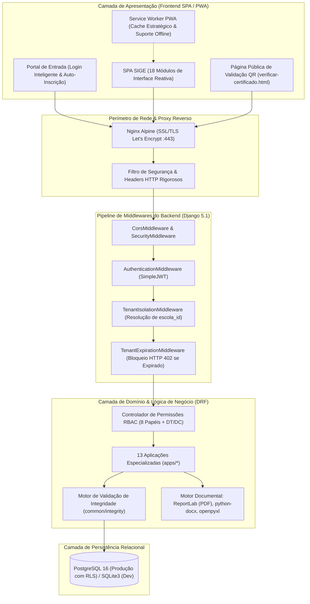
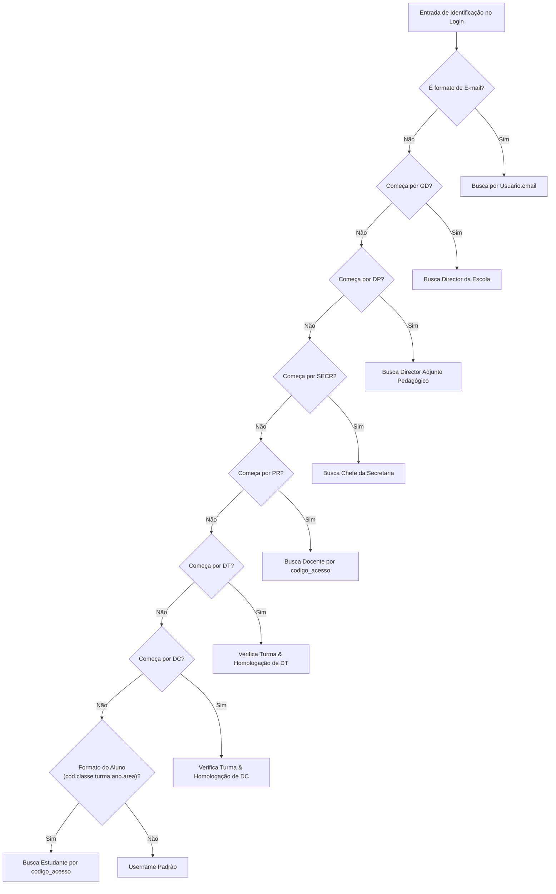
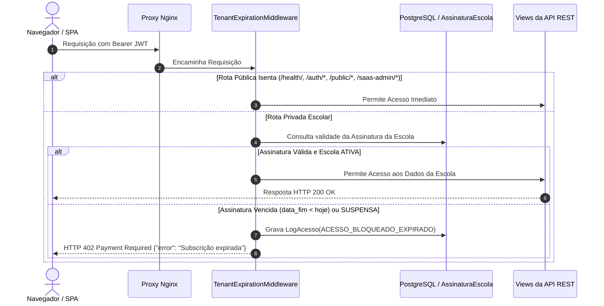

# 🛡️ Arquitetura e Segurança do Sistema — SIGE (v2.5.0)

> **Documento Oficial de Engenharia de Software, Segurança e Governança de Dados**  
> **Conformidade:** Ministério da Educação e Cultura da República de Moçambique (MEC)  
> **Padrão:** ISO/IEC 27001, OWASP ASVS e Princípio de Defesa em Profundidade (*Defense-in-Depth*)

---

## 1. Visão Geral da Arquitetura

O **SIGE (Sistema Integrado de Gestão Escolar)** foi arquitetado como uma aplicação **SaaS Multi-Tenant** de alto desempenho e confiabilidade jurídica, estruturada no modelo desacoplado em duas camadas principais:

1. **Camada de Backend (API RESTful):** Desenvolvida em **Python 3.12** com **Django 5.1** e **Django REST Framework (DRF)**. É o núcleo central responsável pela execução de regras de negócio, garantia de integridade transacional, processamento matemático de notas e emissão de documentos oficiais.
2. **Camada de Frontend (SPA / PWA):** Desenvolvida em **Vanilla JavaScript moderno (ES6+)**, **HTML5**, **CSS3**, **Bootstrap 5.3** e **Chart.js**. Funciona como uma Single-Page Application responsiva, com suporte a Progressive Web App (PWA) e funcionamento otimizado em dispositivos móveis e desktops.



---

## 2. Arquitetura Multi-Tenant e Isolamento de Dados

O SIGE atende centenas de escolas independentes numa mesma infraestrutura compartilhada, exigindo garantias criptográficas e lógicas de não-vazamento de dados entre instituições (*No Cross-Tenant Leaks*).

### 2.1. Particionamento Lógico Obrigatório
Todas as tabelas de dados operacionais (alunos, professores, turmas, notas, pautas, pagamentos, certificados, materiais e logs) contêm obrigatoriamente a chave estrangeira:

```python
escola = models.ForeignKey(
    'tenants.Escola',
    on_delete=models.CASCADE,
    related_name='%(class)s_set',
    db_index=True
)
```

### 2.2. Resolução Dinâmica de Tenant (`TenantIsolationMiddleware`)
Implementado em `backend/common/middleware/tenant.py`:
1. **Decodificação do Token JWT:** A cada requisição autenticada, o middleware extrai a claim `escola_id` presente no payload do token assinado.
2. **Injeção de Contexto:** São atribuídos diretamente ao objeto da requisição `request.escola_id` e `request.escola`.
3. **Imutabilidade para Utilizadores Comuns:** Qualquer tentativa de um utilizador comum adulterar parâmetros na URL (`?escola_id=...`) ou cabeçalhos HTTP é sumariamente ignorada, mantendo a consulta estritamente delimitada à escola vinculada ao seu token.
4. **Inspeção Master SaaS (`SUPERADMIN`):** O perfil `SUPERADMIN` possui permissão para inspecionar qualquer escola sem necessidade de conhecer palavras-passe locais, bastando fornecer o cabeçalho `X-Tenant-ID: <uuid>` ou o parâmetro `?escola_id=<uuid>`.

### 2.3. Validação Cruzada entre Entidades (`Cross-Tenant Linkage Protection`)
Implementado em `backend/common/integrity/tenant_checks.py`, antes de qualquer operação de gravação, o sistema verifica se todos os objetos relacionados pertencem à mesma escola:

$$\text{nota.escola\_id} = \text{aluno.escola\_id} = \text{disciplina.escola\_id} = \text{turma.escola\_id}$$

Se qualquer objeto pertencer a outra escola, uma exceção `CrossTenantViolation` é imediatamente lançada, abortando a transação.

### 2.4. Row-Level Security (RLS) no PostgreSQL
Em produção com PostgreSQL 16 (`backend/supabase_schema_rls.sql`), a segurança é reforçada ao nível do próprio motor SQL:
- Habilita-se `ROW LEVEL SECURITY` em todas as tabelas `sige_*`.
- Políticas SQL garantem que qualquer comando `SELECT`, `INSERT`, `UPDATE` ou `DELETE` filtre automaticamente por `escola_id = auth.user_escola_id()`, a menos que `auth.is_superadmin()` seja verdadeiro.

### 2.5. Desacoplamento Financeiro B2B SaaS vs. B2C Escola
A plataforma aplica uma regra inquebrável de segregação de responsabilidades financeiras:
1. **Governança SaaS B2B (`tenants.Plano` / `SaasPlano`):**
   - Os planos comerciais do SaaS destinam-se exclusivamente à gestão de contratos e quotas entre o **Super Admin** e as **Instituições de Ensino**.
   - Os endpoints de planos SaaS (`/api/v1/planos/`) são estritamente restritos a `SUPERADMIN` (`IsSuperAdmin`). Utilizadores de escolas comuns recebem imediatamente `HTTP 403 Forbidden`.
   - As visualizações de assinatura de escola (`MinhaAssinaturaView` e `RegistarPagamentoInstituicaoView`) rejeitam terminantemente utilizadores dos perfis `ALUNO` e `PROFESSOR`.
2. **Finanças Académicas B2C (`pagamentos.PlanoPagamentoEscola`):**
   - Cada escola tem autonomia plena para criar os seus próprios planos de pagamento, tabelas de propinas e taxas escolares (`sige_planos_pagamento_escola`), associando-os aos seus estudantes.
   - O isolamento multi-tenant impede qualquer contaminação: o que a Escola A configura ou fatura jamais é visto, editado ou refletido na Escola B.
   - Qualquer tentativa de criar uma cobrança (`Pagamento`) associando um plano de pagamento de outra escola é barrada no `clean()` e na API com erro de integridade multi-tenant.

---


## 3. Os 6 Pilares de Integridade (Defesa em Profundidade)

O SIGE implementa 6 camadas concêntricas de proteção para garantir a idoneidade acadêmica e jurídica dos dados:

| Pilar | Dimensão | Mecanismos de Aplicação | Severidade de Violação |
| :---: | :--- | :--- | :---: |
| **I** | **Isolamento Multi-Tenant** | Chave estrangeira `escola_id`, middleware de isolamento, validação cruzada no `clean()`, políticas RLS nativas no PostgreSQL. | **CRÍTICA** (Vazamento de dados) |
| **II** | **Domínio Pedagógico MEC** | Escala numérica de 0.0 a 20.0, fórmulas oficiais de arredondamento, catálogo fechado de siglas (`E`, `MB`, `B`, `S`, `NS`), anotações regulamentares e bloqueio de faltas negativas. | **ALTA** (Inconformidade legal) |
| **III** | **Entidade e Unicidade** | Restrições compostas de unicidade no banco (`UniqueConstraint`): Nota única por aluno/disciplina/período, Pauta única por turma/ano/período, Alocação única de docente. | **ALTA** (Inconsistência de registros) |
| **IV** | **Estado e Imutabilidade** | Pautas homologadas e fechadas bloqueiam terminantemente a alteração de notas; alterações excepcionais exigem autorização nominal com prazo em `PermissaoEdicaoNotas`. | **CRÍTICA** (Fraude de notas) |
| **V** | **Financeiro e Contratos SaaS** | Valores de cobrança estritamente positivos (`valor > 0`), coerência de datas contratuais (`data_fim >= data_inicio`), validação contínua de limites do plano (`max_alunos`, `max_professores`). | **ALTA** (Prejuízo contábil) |
| **VI** | **Auditoria e Não-Repúdio** | Registro de logs de acesso (`LogAcesso`), logs de emissão de documentos (`LogImpressao`), cofre persistente de arquivos gerados (`DocumentoSalvo`) e QR Code criptográfico para verificação pública. | **ALTA** (Perda de rastreabilidade) |

---

## 4. Autenticação Inteligente e Modelo RBAC

O sistema oferece uma camada de autenticação avançada e flexível via `djangorestframework-simplejwt`.

### 4.1. Mecanismo de Login Inteligente
O endpoint `POST /api/v1/auth/login` aceita uma chave de identificação única que resolve automaticamente o utilizador através de múltiplos identificadores:



### 4.2. Os 8 Perfis Nativos e 2 Cargos Homologáveis

| Perfil / Papel | Designação Oficial | Permissões no Sistema |
| :--- | :--- | :--- |
| `SUPERADMIN` | Super Administrador / Engenheiro do Sistema | **Acesso Integral e Universal a Tudo:** Governança global do SaaS, todas as escolas, planos de assinatura, métricas financeiras MRR/ARR, inspeção multi-tenant irrestrita, gestão pedagógica, homologações, pautas, cadernetas e módulos executivos/financeiros sem bloqueios inter-painéis. |
| `ADMIN_ESCOLA` | Administrador da Instituição | Parametrização geral da escola, gestão de utilizadores e turmas, supervisão de todos os módulos escolares locais. |
| `DIRECTOR_ESCOLA` | Director da Escola | Homologação de cargos de DT e DC, encerramento oficial de pautas anuais, assinatura executiva de certificados e pautas. |
| `DAP` | Director Adjunto Pedagógico | Gestão pedagógica integral: turmas, alocações docentes, matriz curricular, cadernetas, pautas, prazos de notas e desbloqueios. |
| `CHEFE_SECRETARIA` | Chefe da Secretaria Escolar | Matrículas de novos alunos, transferências internas e externas, emissão de certidões, declarações, boletins e recibos. |
| `FINANCEIRO` | Gestor Financeiro / Tesouraria | Faturamento de propinas individuais e em lote por turma, liquidação multicanal (M-Pesa, e-Mola, POS, Banco), recibos. |
| `PROFESSOR` | Docente | Lançamento de notas (`ACS`, `MAP`, `MAS`, `AT`) e faltas nas suas disciplinas alocadas, exportação da caderneta e upload de materiais. |
| `DT` *(Cargo Homologado)* | Director de Turma | Atribuído a um professor e homologado pelo Diretor: parametrização da sessão do conselho, emissão da Acta com números por extenso e Pauta Geral. |
| `DC` *(Cargo Homologado)* | Director de Classe | Atribuído a um professor e homologado pelo Diretor: coordenação pedagógica transversal de todas as turmas de uma classe. |
| `ALUNO` | Estudante / Encarregado | Acesso exclusivo ao Portal do Aluno: perfil biográfico, consulta de notas (quando liberadas), material escolar e estado de propinas. |

### 4.3. Ciclo de Vida dos Tokens JWT
- **Access Token:** Validade de **120 minutos**. Contém no payload: `user_id`, `role`, `escola_id`, `nome` e `username`.
- **Refresh Token:** Validade de **7 dias**. Permite a renovação transparente da sessão no endpoint `POST /api/v1/auth/refresh`.

---

## 5. Gestão de Assinaturas e Bloqueio Automático (HTTP 402)

O SIGE inclui controlo contratual automatizado em tempo real através do `TenantExpirationMiddleware`:



---

## 6. Verificação Pública de Certificados por QR Code

Para mitigar falsificações de certificados e declarações escolares:
1. Ao emitir qualquer certificado (`apps.certificados.views`), o sistema gera um código criptográfico único (`CERT-XXXXXXXXXX`).
2. É gerado em tempo real um QR Code vetorial de alta definição incorporado no documento impresso.
3. O QR Code aponta para o validador público oficial:  
   `https://sigesaas.duckdns.org/verificar-certificado.html?codigo=CERT-XXXXXXXXXX`
4. A rota da API `/api/v1/public/verificar-certificado/<codigo>` é pública e imune a bloqueios de assinatura, permitindo que ministérios, embaixadas, universidades e empresas comprovem a veracidade das notas emitidas a qualquer momento.

---

## 7. Governança e Fidelidade Absoluta de Dados (Zero Dados Fictícios)

Em estrita conformidade com os princípios de confiabilidade jurídica e auditoria institucional do SIGE:
1. **Eliminação Integral de Placeholders e Dados Fictícios:** É expressamente vedada a inserção de nomes simulados, dados de teste ou valores fictícios em modelos de dados, seeds, formulários ou relatórios oficiais (`pdf_service.py`, boletins e certificados).
2. **Campos Directivos Nativos Limpos:** Modelos como `Escola` iniciam com valores padrão vazios para `director_nome`, `director_carreira`, `dap_nome` e `chefe_secretaria_nome`, exigindo que a instituição ou a autoridade escolar cadastre exclusivamente informações reais e fidedignas.
3. **Imunidade de Dados Oficiais em Documentos:** Em casos de documentos emitidos com dados de filiação ou certidão incompletos na base escolar, o sistema utiliza marcadores neutros (`---`) em vez de nomes simulados, preservando o valor probatório e a integridade legal da documentação emitida perante o MEC.

