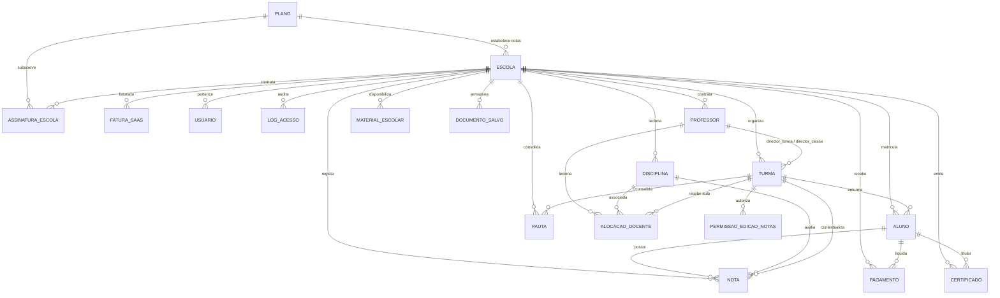

# 🗄️ Dicionário de Dados e Modelos do Sistema — SIGE (v2.5.0)

> **Documento de Especificação Técnica do Banco de Dados Relacional**  
> **Motor:** PostgreSQL 16 (Produção com RLS) / SQLite3 (Desenvolvimento)  
> **ORM:** Django 5.1 ORM (`models.Model`)  
> **Padrão de Nomenclatura:** Tabelas com prefixo canónico `sige_*`, chaves primárias UUID v4, chaves estrangeiras explícitas e constraints compostas.

---

## 1. Visão Geral do Esquema Relacional

---

## 2. Catálogo Detalhado das Tabelas

---

### 2.1. `sige_usuarios` (`apps.accounts.models.Usuario`)
Armazena todos os utilizadores autenticáveis do sistema (8 perfis nativos).

| Campo | Tipo SQL | Nulo? | Descrição / Restrição |
| :--- | :--- | :---: | :--- |
| `id` | `UUID` (PK) | Não | Identificador único global (`uuid4`). |
| `email` | `VARCHAR(254)` | Não | Endereço de correio eletrónico único global (`unique=True`). |
| `username` | `VARCHAR(150)` | Não | Nome de utilizador de acesso (`unique=True`). |
| `nome` | `VARCHAR(255)` | Não | Nome completo do utilizador. |
| `role` | `VARCHAR(30)` | Não | Perfil: `SUPERADMIN`, `ADMIN_ESCOLA`, `DIRECTOR_ESCOLA`, `DAP`, `CHEFE_SECRETARIA`, `FINANCEIRO`, `PROFESSOR`, `ALUNO`. |
| `escola_id` | `UUID` (FK) | Sim | Vinculação à escola (`tenants.Escola`). Nulo apenas para `SUPERADMIN`. |
| `codigo_acesso` | `VARCHAR(50)` | Sim | Código oficial de acesso (`GD...`, `DP...`, `SECR...`, `PR...`, `Aluno`). |
| `aluno_id` | `UUID` | Sim | Vínculo 1:1 lógico com o registo de `Aluno`. |
| `professor_id` | `UUID` | Sim | Vínculo 1:1 lógico com o registo de `Professor`. |
| `ativo` | `BOOLEAN` | Não | Estado da conta (Padrão: `True`). |
| `senha_redefinida`| `BOOLEAN` | Não | Indica se a palavra-passe padrão foi alterada pelo utilizador. |
| `telefone` | `VARCHAR(30)` | Sim | Contacto telefónico moçambicano. |
| `avatar_url` | `VARCHAR(500)` | Sim | URL ou identificador de imagem de perfil. |

---

### 2.2. `sige_logs_acesso` (`apps.accounts.models.LogAcesso`)
Auditoria cronológica e rastreabilidade de acessos e tentativas.

| Campo | Tipo SQL | Nulo? | Descrição / Restrição |
| :--- | :--- | :---: | :--- |
| `id` | `UUID` (PK) | Não | Identificador único global. |
| `escola_id` | `UUID` (FK) | Sim | Escola onde ocorreu o evento. |
| `usuario_id` | `UUID` (FK) | Sim | Utilizador que realizou a ação. |
| `tipo` | `VARCHAR(40)` | Não | `LOGIN_SUCESSO`, `LOGIN_FALHA`, `ACESSO_BLOQUEADO_EXPIRADO`. |
| `ip` | `VARCHAR(45)` | Não | Endereço de rede do cliente no momento da requisição. |
| `user_agent` | `TEXT` | Sim | Identificador do navegador/dispositivo do cliente. |
| `created_at` | `TIMESTAMPTZ` | Não | Carimbo de data/hora exato do evento. |

---

### 2.3. `sige_planos` (`apps.tenants.models.Plano`)
Catálogo de planos comerciais da plataforma SaaS (Subscrições B2B geridas exclusivamente pelo Super Admin para contratos com as escolas). Não é acessível a utilizadores comuns das instituições.

| Campo | Tipo SQL | Nulo? | Descrição / Restrição |
| :--- | :--- | :---: | :--- |
| `id` | `UUID` (PK) | Não | Identificador único global. |
| `nome` | `VARCHAR(100)` | Não | Nome do plano: `MENSAL`, `TRIMESTRAL`, `SEMESTRAL`, `ANUAL`. |
| `preco` | `DECIMAL(10,2)`| Não | Preço do plano em Meticais (`MZN`). |
| `duracao_dias` | `INTEGER` | Não | Período de vigência em dias (30, 90, 180, 365). |
| `max_alunos` | `INTEGER` | Não | Limite máximo contratado de alunos ativos. |
| `max_professores`| `INTEGER` | Não | Limite máximo contratado de docentes ativos. |
| `ativo` | `BOOLEAN` | Não | Se o plano está disponível para novas contratações. |

---

### 2.4. `sige_escolas` (`apps.tenants.models.Escola`)
Registo institucional de cada Tenant na plataforma.

| Campo | Tipo SQL | Nulo? | Descrição / Restrição |
| :--- | :--- | :---: | :--- |
| `id` | `UUID` (PK) | Não | Identificador único da instituição. |
| `nome` | `VARCHAR(255)` | Não | Denominação oficial da escola. |
| `codigo_escola` | `VARCHAR(20)` | Não | Código oficial provincial/distrital (`0808S0001`). |
| `nif_cnpj` | `VARCHAR(30)` | Não | Número Único de Identificação Tributária (NUIT institucional, validado estritamente com até 9 dígitos numéricos, sem letras). |
| `provincia` | `VARCHAR(50)` | Não | Uma das 11 províncias de Moçambique. |
| `distrito` | `VARCHAR(100)` | Não | Um dos 161 distritos de Moçambique. |
| `ano_letivo_ativo`| `VARCHAR(10)` | Não | Ano letivo em curso (ex: `2026`). |
| `trimestre_ativo`| `VARCHAR(20)` | Não | Trimestre em curso (`1_TRIMESTRE`, `2_TRIMESTRE`, `3_TRIMESTRE`). |
| `status` | `VARCHAR(20)` | Não | `ATIVA`, `EXPIRADA`, `SUSPENSA`, `PENDENTE`. |
| `bloqueada_manualmente` | `BOOLEAN` | Não | Bloqueio administrativo direto pelo SuperAdmin. |
| `permitir_visualizacao_notas` | `BOOLEAN` | Não | Liberação de notas no portal do aluno. |
| `inscricoes_abertas` | `BOOLEAN` | Não | Abertura do portal de auto-inscrição pública. |
| `inscricoes_inicio` / `fim` | `DATE` | Sim | Janela temporal de inscrições online. |
| `logo_base64` | `TEXT` | Sim | Imagem do logótipo institucional em Base64 para PDFs. |
| `galeria_logos` | `JSON` | Não | Catálogo e galeria de logótipos institucionais disponíveis. |
| `tema_codigo` | `VARCHAR(50)` | Não | Código do tema de cores oficial (`padrao_azul`, `indigo_save`, etc.). |
| `tema_cor_primaria` / `tema_cor_hover` | `VARCHAR(20)` | Sim | Cores primária e hover da instituição para botões e cabeçalhos. |
| `tema_cor_sidebar` / `tema_cor_sidebar_ativa` | `VARCHAR(20)` | Sim | Cores da barra lateral e elemento activo do menu. |
| `imagem_fundo_url` / `imagem_fundo_base64` | `TEXT` | Sim | Imagem de fundo ou marca d'água oficial personalizada. |
| `imagem_fundo_modo` | `VARCHAR(30)` | Não | Modo de exibição: `marca_dagua`, `cobertura_total`, `padrao_textura`, `nenhum`. |
| `imagem_fundo_opacidade` | `INT` | Não | Nível de opacidade do fundo (5% a 50%, padrão 15%). |
| `galeria_fundos` | `JSON` | Não | Catálogo de imagens de fundo carregadas ou predefinidas pela escola. |
| `config_classes_exames` | `JSON` | Não | Mapeamento de regime de exames por classe/nível (`{"10ª Classe": true, "12ª Classe": true, ...}`). |
| `regime_curricular` | `VARCHAR(20)` | Não | Modelo estrutural da instituição: `CLASSES` (permite exclusivamente da 1ª à 12ª Classe) ou `NIVEIS` (permite exclusivamente Níveis: Nível 1, Nível 2...). Padrão: `CLASSES`. |
| `usar_emblema_nacional` | `BOOLEAN` | Não | Exibição do Emblema da República no cabeçalho. |
| `director_nome` / `dap_nome` / `chefe_secretaria_nome` | `VARCHAR(255)` | Sim | Titulares oficiais dos órgãos diretivos. |

---

### 2.5. `sige_assinaturas_escolas` (`apps.tenants.models.AssinaturaEscola`)
Contratos de subscrição e períodos de vigência de cada instituição.

| Campo | Tipo SQL | Nulo? | Descrição / Restrição |
| :--- | :--- | :---: | :--- |
| `id` | `UUID` (PK) | Não | Identificador do contrato. |
| `escola_id` | `UUID` (FK) | Não | Escola titular da assinatura. |
| `plano_id` | `UUID` (FK) | Não | Plano contratado. |
| `data_inicio` | `DATE` | Não | Data de início de vigência. |
| `data_fim` | `DATE` | Não | Data de encerramento do contrato. |
| `valor` | `DECIMAL(10,2)`| Não | Valor faturado em Meticais (`MZN`). |
| `status` | `VARCHAR(20)` | Não | `ATIVA`, `EXPIRADA`, `CANCELADA`. |
| *Check Constraint* | SQL | — | `CHECK (data_fim >= data_inicio)`. |

---

### 2.6. `sige_alunos` (`apps.alunos.models.Aluno`)
Ficha biográfica e percurso escolar do estudante.

| Campo | Tipo SQL | Nulo? | Descrição / Restrição |
| :--- | :--- | :---: | :--- |
| `id` | `UUID` (PK) | Não | Identificador único do aluno. |
| `escola_id` | `UUID` (FK) | Não | Escola matriculada. |
| `turma_id` | `UUID` (FK) | Sim | Turma em que se encontra alocado. |
| `matricula` | `VARCHAR(30)` | Não | Número oficial de matrícula (`unique=True`). |
| `nome_completo` | `VARCHAR(255)` | Não | Nome e apelidos do aluno. |
| `data_nascimento` | `DATE` | Não | Data de nascimento (validação 10 a 25 anos). |
| `genero` | `VARCHAR(1)` | Não | `M` (Masculino) ou `F` (Feminino). |
| `documento_tipo` | `VARCHAR(20)` | Não | `BI`, `PASSAPORTE`, `DIRE`, `CEDULA`, `CERTIDAO`. |
| `documento_numero`| `VARCHAR(30)` | Não | Número do documento de identificação. |
| `nuit` | `VARCHAR(9)` | Sim | NUIT do aluno validado estritamente com até 9 dígitos numéricos, sem letras (`^\d{1,9}$`). |
| `grau_ano` | `VARCHAR(10)` | Não | Classe escolar: `7`, `8`, `9`, `10`, `11`, `12`. |
| `area` | `VARCHAR(10)` | Sim | Secção: `GERAL`, `CB`, `CD`, `CG`, `LG`, `LH`. |
| `status` | `VARCHAR(20)` | Não | `ACTIVO`, `INACTIVO`, `TRANSFERIDO`, `DESISTENTE`. |

---

### 2.7. `sige_professores` (`apps.professores.models.Professor`)
Corpo docente e enquadramento funcional.

| Campo | Tipo SQL | Nulo? | Descrição / Restrição |
| :--- | :--- | :---: | :--- |
| `id` | `UUID` (PK) | Não | Identificador único do docente. |
| `escola_id` | `UUID` (FK) | Não | Escola de vínculo. |
| `nome_completo` | `VARCHAR(255)` | Não | Nome completo do professor. |
| `email` | `VARCHAR(254)` | Não | Correio eletrónico institucional. |
| `carreira` | `VARCHAR(50)` | Não | Categoria MEC (`DN4`, `DN3`, `DN2`, `DN1`, `Mestre`, etc.). |
| `carga_horaria_semanal` | `INTEGER` | Não | Carga letiva contratada (padrão: 24h, max: 60h). |
| `carga_maxima_por_classe` | `JSONB` | Sim | Limites máximos de aulas semanais por classe. |
| *Unique Constraint* | SQL | — | `UNIQUE (escola_id, email)`. |

---

### 2.8. `sige_professor_disciplina_turma` (`AlocacaoDocente`)
Tabela associativa de alocação de docentes a turmas e disciplinas.

| Campo | Tipo SQL | Nulo? | Descrição / Restrição |
| :--- | :--- | :---: | :--- |
| `id` | `UUID` (PK) | Não | Identificador da alocação. |
| `escola_id` | `UUID` (FK) | Não | Escola de contexto. |
| `professor_id` | `UUID` (FK) | Não | Docente alocado. |
| `disciplina_id` | `UUID` (FK) | Não | Disciplina a lecionar. |
| `turma_id` | `UUID` (FK) | Não | Turma onde se realiza a docência. |
| `ano_letivo` | `VARCHAR(10)` | Não | Ano letivo da alocação. |
| *Unique Constraint* | SQL | — | `UNIQUE (escola_id, professor_id, disciplina_id, turma_id, ano_letivo)`. |

---

### 2.9. `sige_turmas` (`apps.turmas.models.Turma`)
Organização das classes e salas da escola.

| Campo | Tipo SQL | Nulo? | Descrição / Restrição |
| :--- | :--- | :---: | :--- |
| `id` | `UUID` (PK) | Não | Identificador da turma. |
| `escola_id` | `UUID` (FK) | Não | Escola detentora da turma. |
| `nome` | `VARCHAR(50)` | Não | Nome formal da turma (ex: `Turma 1`). |
| `grau_ano` | `VARCHAR(10)` | Não | Classe da turma (`7` a `12`). |
| `area` | `VARCHAR(10)` | Não | Secção da turma (`GERAL`, `CB`, `CD`, `CG`, `LG`, `LH`). |
| `turno` | `VARCHAR(10)` | Não | `MANHA`, `TARDE`, `NOITE`. |
| `sala` | `VARCHAR(50)` | Sim | Identificação da sala de aula física. |
| `capacidade_maxima`| `INTEGER` | Não | Limite de lotação (padrão: 50 alunos). |
| `director_turma_id`| `UUID` (FK) | Sim | Professor titular de Direção de Turma. |
| `director_classe_id`| `UUID` (FK) | Sim | Professor titular de Direção de Classe. |
| `dt_status_homologacao` | `VARCHAR(30)` | Não | `NAO_ATRIBUIDO`, `PENDENTE_HOMOLOGACAO`, `HOMOLOGADO`. |
| `dc_status_homologacao` | `VARCHAR(30)` | Não | `NAO_ATRIBUIDO`, `PENDENTE_HOMOLOGACAO`, `HOMOLOGADO`. |
| *Unique Constraint* | SQL | — | `UNIQUE (escola_id, grau_ano, nome, ano_letivo)`. |

---

### 2.10. `sige_disciplinas` (`apps.disciplinas.models.Disciplina`)
Grelha curricular nacional.

| Campo | Tipo SQL | Nulo? | Descrição / Restrição |
| :--- | :--- | :---: | :--- |
| `id` | `UUID` (PK) | Não | Identificador da disciplina. |
| `escola_id` | `UUID` (FK) | Não | Escola proprietária da matriz. |
| `nome` | `VARCHAR(100)` | Não | Nome da disciplina (ex: *Matemática*). |
| `codigo` | `VARCHAR(20)` | Não | Código canónico (`MAT-10`, `BIO-12CB`). |
| `classe` | `VARCHAR(10)` | Não | Classe curricular correspondente. |
| `area` | `VARCHAR(10)` | Não | Secção de enquadramento. |
| `carga_horaria` | `INTEGER` | Não | Carga letiva semanal em horas. |
| *Unique Constraint* | SQL | — | `UNIQUE (escola_id, codigo, ano_letivo)`. |

---

### 2.11. `sige_notas` (`apps.notas.models.Nota`)
Registo quantitativo e qualitativo de avaliações.

| Campo | Tipo SQL | Nulo? | Descrição / Restrição |
| :--- | :--- | :---: | :--- |
| `id` | `UUID` (PK) | Não | Identificador da avaliação. |
| `escola_id` | `UUID` (FK) | Não | Escola de contexto. |
| `aluno_id` | `UUID` (FK) | Não | Aluno avaliado. |
| `disciplina_id` | `UUID` (FK) | Não | Disciplina avaliada. |
| `turma_id` | `UUID` (FK) | Não | Turma em que foi avaliado. |
| `periodo` | `VARCHAR(20)` | Não | `1_TRIMESTRE`, `2_TRIMESTRE`, `3_TRIMESTRE`, `ANUAL`. |
| `teste1` / `teste2` / `teste3` | `FLOAT` | Sim | Avaliações Contínuas (`1ª ACS`, `2ª ACS`, `3ª ACS`). |
| `teste4` / `trabalho` | `FLOAT` | Sim | `MAP` (Práticas) e `MAS` (Trabalhos/Sistemáticas). |
| `avaliacao_trimestral` | `FLOAT` | Sim | Prova Trimestral (`AT` / ACP). |
| `media_final` | `FLOAT` | Sim | Nota de fechamento (`MT` ou `MFD`). |
| `faltas` | `INTEGER` | Não | Faltas acumuladas no período (Padrão: 0). |
| `comportamento` | `VARCHAR(5)` | Sim | Sigla qualitativa: `E`, `MB`, `B`, `S`, `NS`. |
| `anotacao` | `VARCHAR(10)` | Sim | Código oficial: `D`, `T`, `VT`, `F`, `AM`, `PPF`, `PDF`. |
| `resultado` | `VARCHAR(20)` | Sim | `Aprovado`, `Reprovado`, `Pendente`. |
| *Unique Constraint* | SQL | — | `UNIQUE (aluno_id, disciplina_id, turma_id, periodo)`. |
| *Check Constraints*| SQL | — | `CHECK (media_final >= 0 AND media_final <= 20)` e `CHECK (faltas >= 0)`. |

---

### 2.12. `sige_pautas` (`apps.pautas.models.Pauta`)
Estado de consolidação e encerramento de pautas de turma.

| Campo | Tipo SQL | Nulo? | Descrição / Restrição |
| :--- | :--- | :---: | :--- |
| `id` | `UUID` (PK) | Não | Identificador da pauta. |
| `escola_id` | `UUID` (FK) | Não | Escola titular. |
| `turma_id` | `UUID` (FK) | Não | Turma consolidada. |
| `ano_letivo` | `VARCHAR(10)` | Não | Ano letivo de referência. |
| `periodo` | `VARCHAR(20)` | Não | Período consolidado. |
| `status` | `VARCHAR(20)` | Não | `ABERTA`, `EM_CONSOLIDACAO`, `FECHADA`. |
| `fechada_por` | `VARCHAR(255)` | Sim | Nome da autoridade que homologou o fecho. |
| `data_fechamento` | `TIMESTAMPTZ` | Sim | Data e hora em que a pauta foi congelada. |
| *Unique Constraint* | SQL | — | `UNIQUE (escola_id, turma_id, ano_letivo, periodo)`. |

---

### 2.13. `sige_permissoes_edicao_notas` (`PermissaoEdicaoNotas`)
Autorizações excecionais e auditadas de desbloqueio de notas.

| Campo | Tipo SQL | Nulo? | Descrição / Restrição |
| :--- | :--- | :---: | :--- |
| `id` | `UUID` (PK) | Não | Identificador da autorização. |
| `escola_id` | `UUID` (FK) | Não | Escola de contexto. |
| `turma_id` | `UUID` (FK) | Não | Turma autorizada. |
| `disciplina_id` | `UUID` (FK) | Sim | Disciplina específica (ou nulo para todas da turma). |
| `professor_id` | `UUID` (FK) | Sim | Professor específico (ou nulo para todos). |
| `trimestre` | `VARCHAR(20)` | Não | Trimestre desbloqueado. |
| `data_limite` | `TIMESTAMPTZ` | Não | Prazo final para conclusão das alterações. |
| `motivo` | `TEXT` | Não | Justificativa formal da concessão de desbloqueio. |
| `autorizado_por_id` | `UUID` (FK) | Não | DAP ou Diretor que emitiu o desbloqueio. |
| `ativo` | `BOOLEAN` | Não | Estado da autorização. |

---

### 2.14. `sige_material_escolar` (`apps.material_escolar.models.MaterialEscolar`)
Biblioteca pedagógica de conteúdos didáticos.

| Campo | Tipo SQL | Nulo? | Descrição / Restrição |
| :--- | :--- | :---: | :--- |
| `id` | `UUID` (PK) | Não | Identificador do material. |
| `escola_id` | `UUID` (FK) | Não | Escola de publicação. |
| `titulo` | `VARCHAR(255)` | Não | Título da obra/manual/ficha. |
| `classe` | `VARCHAR(10)` | Não | Classe escolar recomendada (`1` a `12`). |
| `tipo` | `VARCHAR(30)` | Não | `MANUAL`, `FICHA`, `LIVRO`, `EXERCICIOS`, `GUIA`, `APOSTILA`. |
| `formato` | `VARCHAR(10)` | Não | Extensão: `PDF`, `DOCX`, `XLSX`, `PPTX`, `EPUB`, `ZIP`, `IMG`. |
| `tamanho_bytes` | `INTEGER` | Não | Tamanho do ficheiro (limite: 15 MB). |
| `conteudo_base64`| `TEXT` | Sim | Ficheiro binário codificado para persistência local. |
| `arquivo_url` | `VARCHAR(500)` | Sim | URL externa alternativa. |

---

### 2.15. `sige_pagamentos` (`apps.pagamentos.models.Pagamento`)
Gestão financeira de propinas e emissão de recibos oficiais escolares.

| Campo | Tipo SQL | Nulo? | Descrição / Restrição |
| :--- | :--- | :---: | :--- |
| `id` | `UUID` (PK) | Não | Identificador da cobrança. |
| `escola_id` | `UUID` (FK) | Não | Escola credora. |
| `aluno_id` | `UUID` (FK) | Não | Aluno devedor/titular. |
| `plano_pagamento_id` | `UUID` (FK) | Sim | Chave estrangeira para `sige_planos_pagamento_escola` (validação multi-tenant no mesmo `escola_id`). |
| `tipo_pagamento` | `VARCHAR(30)` | Não | `MENSALIDADE`, `MATRICULA`, `EXAME`, `CERTIFICADO`, `OUTRO`. |
| `mes_referencia` | `INTEGER` | Sim | Mês da mensalidade (1 a 12). |
| `ano_referencia` | `INTEGER` | Não | Ano da propina (ex: 2026). |
| `valor` | `DECIMAL(10,2)`| Não | Valor da propina em Meticais (`MZN`). |
| `valor_pago` | `DECIMAL(10,2)`| Não | Quantia liquidada. |
| `data_vencimento` | `DATE` | Não | Data limite para pagamento sem juros/multa. |
| `status` | `VARCHAR(20)` | Não | `PENDENTE`, `PAGO`, `ATRASADO`, `CANCELADO`. |
| `metodo_pagamento`| `VARCHAR(30)` | Sim | `MPESA`, `EMOLA`, `POS`, `TRANSFERENCIA`, `NUMERARIO`. |
| `numero_recibo` | `VARCHAR(50)` | Sim | Identificador único de recibo (`REC-2026-00001`). |
| `data_pagamento` | `TIMESTAMPTZ` | Sim | Data e hora da quitação. |
| `observacoes` | `TEXT` | Sim | Descrição ou anotações complementares. |
| *Check Constraints*| SQL | — | `CHECK (valor > 0)` e `CHECK (valor_pago >= 0)`. |

---

### 2.15.1. `sige_planos_pagamento_escola` (`apps.pagamentos.models.PlanoPagamentoEscola`)
Tabela de planos de propinas e emolumentos próprios de cada instituição escolar (B2C), com total isolamento multi-tenant.

| Campo | Tipo SQL | Nulo? | Descrição / Restrição |
| :--- | :--- | :---: | :--- |
| `id` | `UUID` (PK) | Não | Identificador do plano escolar. |
| `escola_id` | `UUID` (FK) | Não | Escola proprietária do plano de propina. |
| `nome` | `VARCHAR(150)` | Não | Designação do plano (ex: *Propina Geral 10ª Classe*). |
| `descricao` | `TEXT` | Sim | Descrição dos serviços, taxas e condições incluídas. |
| `valor` | `DECIMAL(10,2)`| Não | Valor base da propina ou emolumento em Meticais (`MZN`). |
| `periodicidade` | `VARCHAR(20)` | Não | `MENSAL`, `TRIMESTRAL`, `SEMESTRAL`, `ANUAL`, `UNICA`. |
| `dia_vencimento_padrao` | `INTEGER` | Não | Dia padrão de vencimento todo mês (1 a 31, default 10). |
| `multa_atraso_percentual` | `DECIMAL(5,2)` | Não | Percentual de penalização por atraso (default 0.00%). |
| `multa_atraso_fixo` | `DECIMAL(10,2)` | Não | Valor fixo de penalização por atraso em MZN (default 0.00). |
| `ativo` | `BOOLEAN` | Não | Se o plano está disponível para novas emissões (default True). |
| `created_at` | `TIMESTAMPTZ` | Não | Data/hora de criação do registo. |
| `updated_at` | `TIMESTAMPTZ` | Não | Data/hora da última alteração. |
| *Integridade Multi-Tenant* | Validação Python | — | `validar_integridade_tenant(self, aluno, plano)` garante que planos e alunos pertencem à mesma escola. |

---

### 2.16. `sige_certificados` (`apps.certificados.models.Certificado`)
Emissão de certificados digitais e validação pública.

| Campo | Tipo SQL | Nulo? | Descrição / Restrição |
| :--- | :--- | :---: | :--- |
| `id` | `UUID` (PK) | Não | Identificador do certificado. |
| `escola_id` | `UUID` (FK) | Não | Escola emissora. |
| `aluno_id` | `UUID` (FK) | Não | Estudante titular. |
| `tipo` | `VARCHAR(30)` | Não | `CONCLUSAO`, `TRANSFERENCIA`, `DECLARACAO`, `MATRICULA`. |
| `codigo_autenticidade`| `VARCHAR(50)` | Não | Código criptográfico público (`CERT-XXXXXXXXXX`). |
| `qrcode_data` | `TEXT` | Não | URL do validador público incorporada no QR Code. |
| `data_emissao` | `DATE` | Não | Data oficial de emissão. |

---

### 2.17. `sige_documentos_salvos` (`DocumentoSalvo`) & `sige_logs_impressao`
Cofre persistente de ficheiros emitidos e auditoria de impressões.

| Tabela / Campo | Tipo SQL | Nulo? | Descrição / Restrição |
| :--- | :--- | :---: | :--- |
| **`sige_documentos_salvos`** | | | **Cofre Binário de Documentos Emitidos** |
| `id` | `UUID` (PK) | Não | Identificador do documento salvo. |
| `escola_id` | `UUID` (FK) | Não | Escola emissora. |
| `nome_arquivo` | `VARCHAR(255)` | Não | Nome formal do ficheiro (ex: `pauta_10a_t1.pdf`). |
| `tipo_documento` | `VARCHAR(50)` | Não | `boletim`, `declaracao`, `certificado`, `pauta`, `acta`, `caderneta`. |
| `formato` | `VARCHAR(10)` | Não | `pdf`, `docx`, `xlsx`. |
| `conteudo_base64` | `TEXT` | Não | Binário integral codificado em Base64. |
| `tamanho_bytes` | `INTEGER` | Não | Tamanho do ficheiro no cofre. |
| **`sige_logs_impressao`** | | | **Auditoria de Documentos e Parâmetros** |
| `escola_id` | `UUID` (FK) | Não | Escola de contexto. |
| `usuario_id` | `UUID` (FK) | Não | Operador que solicitou o documento. |
| `tipo_documento` | `VARCHAR(50)` | Não | Tipo de documento emitido. |
| `parametros_json` | `JSONB` | Sim | Armazena configurações de sessões de conselho, etc. |

---

### 2.18. Módulos SaaS de Assinaturas, Planos e Pagamentos Institucionais

#### `sige_saas_planos` (`apps.tenants.models.SaasPlano`)
Planos de subscrição corporativa do sistema SIGE SaaS (ex: **Plano Básico**).

| Campo | Tipo SQL | Nulo? | Descrição / Restrição |
| :--- | :--- | :---: | :--- |
| `id` | `UUID` (PK) | Não | Identificador do plano SaaS. |
| `nome` | `VARCHAR(100)` | Não | Nome do plano (ex: `Plano Básico`). Único. |
| `descricao` | `TEXT` | Sim | Descrição dos recursos contratados. |
| `preco_mensal` | `DECIMAL(12,2)`| Não | Mensalidade padrão em Meticais (`MZN`). |
| `limite_alunos` | `INTEGER` | Não | Quota máxima de alunos ativos (ex: 500). |
| `limite_professores` | `INTEGER` | Não | Quota máxima de professores ativos (ex: 50). |
| `limites` | `JSONB` | Não | Limites detalhados adicionais. |
| `activo` | `BOOLEAN` | Não | Indica se o plano está aberto a novas contratações. |

#### `sige_saas_assinaturas` (`apps.tenants.models.SaasAssinatura`)
Subscrições ativas das instituições de ensino no SIGE SaaS.

| Campo | Tipo SQL | Nulo? | Descrição / Restrição |
| :--- | :--- | :---: | :--- |
| `id` | `UUID` (PK) | Não | Identificador da assinatura SaaS. |
| `instituicao_id` | `UUID` (FK) | Não | Instituição assinante (`sige_escolas`). |
| `plano_id` | `UUID` (FK) | Não | Plano contratado (`sige_saas_planos`). |
| `periodicidade` | `VARCHAR(20)` | Não | `mensal`, `trimestral`, `semestral`, `anual`. |
| `estado` | `VARCHAR(30)` | Não | `teste`, `activa`, `fatura_pendente`, `em_atraso`, `restrita`, `suspensa`, `cancelada`. |
| `proxima_fatura_em` | `DATE` | Não | Data da emissão do próximo ciclo de faturação. |

#### `sige_saas_coordenadas` (`apps.tenants.models.SaasCoordenadasPagamento`)
Coordenadas bancárias e carteiras móveis oficiais da plataforma (M-Pesa, e-Mola, BIM, BCI).

---

### 2.19. Central de Gateway SMS, USSD e Pagamentos Móveis (`apps.ferramentas`)

#### `sige_mensagens_sms` (`apps.ferramentas.models.MensagemSMS`)
Registo de cada mensagem SMS disparada pelo sistema para encarregados e alunos.

| Campo | Tipo SQL | Nulo? | Descrição / Restrição |
| :--- | :--- | :---: | :--- |
| `id` | `UUID` (PK) | Não | Identificador único da mensagem SMS. |
| `escola_id` | `UUID` (FK) | Sim | Escola emissora do SMS. |
| `destinatario` | `VARCHAR(30)` | Não | Número normalizado internacional de Moçambique (`+258XXXXXXXXX`). |
| `nome_destinatario` | `VARCHAR(255)` | Sim | Nome do encarregado de educação ou estudante. |
| `operadora` | `VARCHAR(20)` | Não | `VODACOM`, `MOVITEL`, `TMCEL` ou `OUTRA`. |
| `mensagem` | `TEXT` | Não | Texto integral da mensagem SMS. |
| `tipo` | `VARCHAR(30)` | Não | `AVISO`, `PROPINA`, `RECIBO`, `NOTAS`, `REUNIAO`, `FALTA`. |
| `caracteres` | `INTEGER` | Não | Contagem total de caracteres do texto. |
| `segmentos_sms` | `INTEGER` | Não | Número de segmentos SMS faturados (GSM-7 de 160 vs. UCS-2 de 70). |
| `status` | `VARCHAR(20)` | Não | `PENDENTE`, `ENVIADO`, `ENTREGUE`, `FALHOU`. |
| `mensagem_id_operadora`| `VARCHAR(100)`| Sim | ID do lote ou protocolo retornado pela gateway da operadora. |
| `created_at` | `TIMESTAMP` | Não | Data e hora do disparo. |

#### `sige_transacoes_gateway_movel` (`apps.ferramentas.models.TransacaoGatewayMovel`)
Registo de transações de carteira móvel (M-Pesa C2B e e-Mola) com liquidação automática de propinas.

| Campo | Tipo SQL | Nulo? | Descrição / Restrição |
| :--- | :--- | :---: | :--- |
| `id` | `UUID` (PK) | Não | Identificador único da transação. |
| `escola_id` | `UUID` (FK) | Sim | Escola beneficiária. |
| `pagamento_id` | `UUID` (FK) | Sim | Vinculação direta ao registo de propina em `sige_pagamentos`. |
| `aluno_id` | `UUID` (FK) | Sim | Aluno beneficiário em `sige_alunos`. |
| `metodo` | `VARCHAR(20)` | Não | Carteira móvel utilizada: `MPESA` ou `EMOLA`. |
| `telefone` | `VARCHAR(30)` | Não | Número do telemóvel do pagador (`+258XXXXXXXXX`). |
| `valor` | `DECIMAL(12,2)`| Não | Valor pago em Meticais (`MZN`). |
| `referencia_transacao` | `VARCHAR(100)`| Não | Código de referência bancária gerado pela rede móvel. Único. |
| `recibo_emitido` | `VARCHAR(50)` | Sim | Número do recibo oficial emitido (`REC-YYYYMM-XXXXXX`). |
| `status` | `VARCHAR(20)` | Não | `PENDENTE`, `PROCESSANDO`, `CONCLUIDO`, `FALHOU`. |
| `mensagem_retorno` | `TEXT` | Sim | Mensagem de confirmação ou log retornado pela API da operadora. |
| `created_at` | `TIMESTAMP` | Não | Data e hora do início da transação. |
| `updated_at` | `TIMESTAMP` | Não | Data e hora da última alteração de estado. |

#### `sige_configuracoes_gateway` (`apps.ferramentas.models.ConfiguracaoGateway`)
Configurações operacionais dos canais de telecomunicações e pagamentos por escola (tenant).

| Campo | Tipo SQL | Nulo? | Descrição / Restrição |
| :--- | :--- | :---: | :--- |
| `id` | `UUID` (PK) | Não | Identificador único da configuração. |
| `escola_id` | `UUID` (FK) | Sim | Escola vinculada (tenant). |
| `canal_envio_padrao` | `VARCHAR(30)` | Não | Canal pré-definido: `ANDROID_GATEWAY`, `WHATSAPP` ou `SANDBOX`. |
| `android_gateway_url` | `VARCHAR(255)`| Sim | URL local do telemóvel Android com o SIM da escola. |
| `whatsapp_numero_escola` | `VARCHAR(30)` | Sim | Número do WhatsApp institucional da escola. |
| `mpesa_shortcode` | `VARCHAR(30)` | Sim | Shortcode comercial M-Pesa (Vodacom). |
| `mpesa_api_key` | `VARCHAR(255)`| Sim | Chave de integração M-Pesa OpenAPI. |
| `updated_at` | `TIMESTAMP` | Não | Data da última alteração. |

#### `sige_mensagens_whatsapp` (`apps.ferramentas.models.MensagemWhatsApp`)
Registo de mensagens disparadas via WhatsApp Escolar (1-clique gratuito).

| Campo | Tipo SQL | Nulo? | Descrição / Restrição |
| :--- | :--- | :---: | :--- |
| `id` | `UUID` (PK) | Não | Identificador único da mensagem. |
| `escola_id` | `UUID` (FK) | Sim | Escola emissora. |
| `destinatario` | `VARCHAR(30)` | Não | Número normalizado internacional (`+258XXXXXXXXX`). |
| `nome_destinatario` | `VARCHAR(255)`| Sim | Nome do encarregado de educação ou estudante. |
| `mensagem` | `TEXT` | Não | Conteúdo integral da mensagem. |
| `tipo` | `VARCHAR(30)` | Não | `AVISO`, `PROPINA`, `RECIBO`, `NOTAS`, `REUNIAO`, `FALTA`. |
| `link_wa` | `TEXT` | Sim | Link direto `https://wa.me/...` gerado para disparo rápido. |
| `status` | `VARCHAR(20)` | Não | `GERADO`, `ENVIADO`, `ENTREGUE`, `FALHOU`. |
| `created_at` | `TIMESTAMP` | Não | Data e hora da criação/disparo. |

#### `sige_reconciliacoes_sms_movel` (`apps.ferramentas.models.ReconciliacaoSmsMovel`)
Armazenamento e auditoria de SMS de confirmação recebidos do M-Pesa ou e-Mola para liquidação automática a custo zero.

| Campo | Tipo SQL | Nulo? | Descrição / Restrição |
| :--- | :--- | :---: | :--- |
| `id` | `UUID` (PK) | Não | Identificador único do SMS reconciliado. |
| `escola_id` | `UUID` (FK) | Sim | Escola destinatária. |
| `origem` | `VARCHAR(50)` | Não | `MPESA`, `EMOLA` ou remetente do SMS. |
| `remetente_telefone` | `VARCHAR(30)`| Sim | Número de telefone que transferiu o valor. |
| `texto_sms` | `TEXT` | Não | Conteúdo bruto integral do SMS bancário recebido. |
| `valor_extraido` | `DECIMAL(12,2)`| Não | Valor extraído em Meticais (`MZN`). |
| `referencia_transacao` | `VARCHAR(100)`| Não | Referência bancária única extraída por regex (`db_index=True`). |
| `aluno_id` | `UUID` (FK) | Sim | Aluno vinculado à quitação da propina. |
| `pagamento_id` | `UUID` (FK) | Sim | Pagamento liquidado em `sige_pagamentos`. |
| `status` | `VARCHAR(20)` | Não | `PROCESSADO`, `PENDENTE`, `DUPLICADO`, `ERRO`. |
| `created_at` | `TIMESTAMP` | Não | Data e hora da receção e reconciliação. |

