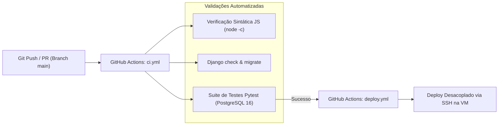

# 🚀 Guia de Implantação, DevOps e Infraestrutura — SIGE (v2.5.0)

> **Manual de Engenharia de Confiabilidade (SRE), CI/CD e Implantação em Nuvem**  
> **Domínio de Produção Oficial:** `https://sigesaas.duckdns.org/`  
> **API REST Oficial (HTTPS):** `https://sigesaas.duckdns.org/api/v1/`  
> **Guardrail Financeiro Obrigatório:** Custo total de infraestrutura $\le \text{US}\$ 6\text{/mês}$

---

## 1. Princípios de Infraestrutura e Governança

### 1.1. Regra Inquebrável: Ocultação Total de Endereços IP
- **NUNCA exibir endereços IP** (nem brutos nem derivados) em documentos, atalhos, mensagens ou documentação pública.
- Todos os serviços em nuvem são acedidos exclusivamente através do domínio oficial protegido com SSL/TLS:
  - **Portal Web:** `https://sigesaas.duckdns.org/`
  - **API REST (HTTPS):** `https://sigesaas.duckdns.org/api/v1/`
  - **Swagger UI:** `https://sigesaas.duckdns.org/api/docs/`
- Os atalhos de ambiente de trabalho locais (`sige.url`, `sige.cmd`) devem apontar exclusivamente para `https://sigesaas.duckdns.org/`.

### 1.2. Guardrail de Orçamento ($\le \text{US}\$ 6\text{/mês}$)
A arquitetura do SIGE foi desenhada para operar com altíssima eficiência de recursos, viabilizando execução sustentável:
- **Máquina Virtual (VM) Recomendada:**
  - *Google Cloud Platform (GCP):* Instância `e2-micro` (gratuita no Free Tier na região `us-central1`, `us-east1` ou `us-west1`) ou VPS básica Ubuntu 22.04 / 24.04 LTS (1 vCPU, 1 a 2 GB RAM, 25 GB SSD) com custo na faixa de US\$ 3,50 a US\$ 5,50/mês.
- **Estratégias de Otimização de Custos:**
  - Ativação de **Swap de 2 GB** no Linux para suportar picos de compilação sem necessidade de upgrade de RAM.
  - Proxy reverso com Nginx Alpine com compressão Gzip e cache agressivo de arquivos estáticos.
  - Entrega de estáticos via WhiteNoise no backend Django.
  - Certificados SSL/TLS gratuitos emitidos e renovados automaticamente pelo Let's Encrypt (`certbot`).

---

## 2. Execução Local em Ambiente de Desenvolvimento

### 2.1. Requisitos Prévios
- **Python 3.12+** instalado.
- **Node.js 18+** instalado.
- **Git** configurado.

### 2.2. Passo a Passo no Windows / Linux

#### 1. Configurar e Iniciar o Backend (Django):
```powershell
# Aceder à pasta do backend
cd backend

# Criar e ativar o ambiente virtual Python
python -m venv venv
.\venv\Scripts\activate      # No Linux/macOS: source venv/bin/activate

# Instalar dependências
pip install -r requirements.txt

# Aplicar migrações do banco de dados (SQLite3 para desenvolvimento)
python manage.py migrate

# Popular o banco de dados com a escola de demonstração (Massinga)
python manage.py seed
```

#### 2. Iniciar o Sistema Completo (Backend + Frontend):
Na raiz do projeto (`d:\SIGE`):
```powershell
# Iniciar ambos os servidores simultaneamente via npm:
npm start

# Ou no Windows através do script dedicado:
.\scripts\sige.bat
```
- **Frontend SPA:** `http://localhost:5173`
- **Backend API & Swagger:** `http://localhost:8000/api/docs/`

---

## 3. Orquestração com Docker Compose

O ficheiro `docker-compose.yml` na raiz do projeto permite subir todo o ecossistema SIGE contentorizado com um único comando:

```bash
docker compose up -d --build
```

### Contentores Orquestrados:
1. `sige_postgres`: Base de dados PostgreSQL 16 Alpine na porta `5432`.
2. `sige_backend`: Aplicação Django WSGI / Gunicorn na porta `8000`.
3. `sige_frontend`: Servidor Web Nginx Alpine servindo a SPA nas portas `80`, `443` e `5173`.
4. `sige_pgadmin`: Interface administrativa para inspeção do banco na porta `5050`.

Para verificar o estado dos contentores:
```bash
docker compose ps
docker compose logs -f backend
```

---

## 4. Pipeline de Integração Contínua (CI/CD)

O SIGE possui fluxos de trabalho automatizados no GitHub Actions:



### 4.1. Suite de Testes Automatizados (`backend/tests/`)
Para rodar a suite de testes no backend:
```bash
cd backend
pytest -v
```
A suite valida:
- Emissão e renovação de tokens JWT.
- Isolamento multi-tenant entre escolas.
- Bloqueio HTTP 402 para assinaturas vencidas.
- Fórmulas de cálculo de notas do MEC (`MAC`, `MT`, `MFD`).
- Algoritmos de aprovação da 7ª–11ª classe vs. 12ª classe.
- Geração correta de documentos em PDF, Word e Excel.

---

## 5. Procedimento de Deploy Desacoplado em Produção

O deploy em produção é executado de forma desacoplada para evitar indisponibilidade:

```bash
# 1. Atualizar e validar a API Backend primeiro
cd /var/www/sige/backend
git pull origin main
source venv/bin/activate
pip install -r requirements.txt
python manage.py migrate
sudo systemctl restart sige-backend
curl -f https://sigesaas.duckdns.org/health/ || exit 1

# 2. Atualizar o Frontend e recarregar o Nginx
cd /var/www/sige/frontend
git pull origin main
sudo systemctl reload nginx
```

### 5.1. Configuração do Proxy Reverso Nginx (`/etc/nginx/sites-available/sige`)
```nginx
server {
    server_name sigesaas.duckdns.org;

    # Frontend SPA estático
    location / {
        root /var/www/sige/frontend;
        index index.html;
        try_files $uri $uri/ /index.html;
    }

    # Proxy reverso para API Backend Django
    location /api/ {
        proxy_pass http://127.0.0.1:8000;
        proxy_set_header Host $host;
        proxy_set_header X-Real-IP $remote_addr;
        proxy_set_header X-Forwarded-For $proxy_add_x_forwarded_for;
        proxy_set_header X-Forwarded-Proto $scheme;
    }

    # Proxy para verificação de saúde
    location /health/ {
        proxy_pass http://127.0.0.1:8000/health/;
    }

    listen 443 ssl http2;
    ssl_certificate /etc/letsencrypt/live/sigesaas.duckdns.org/fullchain.pem;
    ssl_certificate_key /etc/letsencrypt/live/sigesaas.duckdns.org/privkey.pem;
}
```

---

## 6. Procedimentos de Cópia de Segurança (Backup) e Restauração

### 6.1. Backup Diário do Banco de Dados PostgreSQL
Rotina agendada via Cron na máquina virtual:
```bash
# Exportar banco com compressão e carimbo de data/hora
pg_dump -U sige_user -d sige_db -F c -b -v -f "/backups/sige_db_$(date +%Y%m%d_%H%M%S).dump"
```

### 6.2. Procedimento de Restauração em Caso de Desastre
```bash
# Restaurar o banco a partir do arquivo comprimido
pg_restore -U sige_user -d sige_db -v -c "/backups/sige_db_20261017_120000.dump"
```
