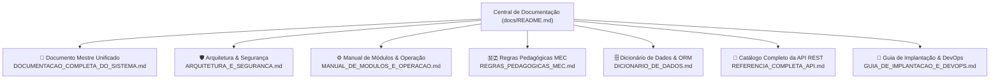

# 📚 Central de Documentação do SIGE (v2.5.0)
### Sistema Integrado de Gestão Escolar — Plataforma SaaS Multi-Tenant (MEC — Moçambique)

Bem-vindo à central oficial de documentação técnica, pedagógica, arquitetural e operacional do **SIGE**. Esta documentação foi elaborada para atender desenvolvedores, administradores de sistemas, diretores escolares, equipas pedagógicas e operadores de secretaria.

---

## 🗺️ Mapa da Documentação

A documentação está estruturada de forma modular para permitir consulta rápida e aprofundamento específico:

---

## 📂 Guias Especializados

| Documento | Descrição e Escopo | Público-Alvo Principal |
| :--- | :--- | :--- |
| **[📘 Documentação Completa do Sistema](DOCUMENTACAO_COMPLETA_DO_SISTEMA.md)** | Visão panorâmica unificada: arquitetura, modelos, módulos, API, regras pedagógicas e DevOps num único documento mestre de referência. | Todos os públicos |
| **[🛡️ Arquitetura e Segurança](ARQUITETURA_E_SEGURANCA.md)** | Defesa em profundidade, isolamento multi-tenant (`TenantIsolationMiddleware`), Row-Level Security (RLS), RBAC com 8 perfis e 2 cargos homologados, ciclo de vida de tokens JWT e bloqueio automático HTTP 402. | Arquitetos, Engenheiros de Software, DevSecOps |
| **[⚙️ Manual de Módulos e Operação](MANUAL_DE_MODULOS_E_OPERACAO.md)** | Guia operacional detalhado dos 18 módulos do sistema: do portal público de auto-inscrição à caderneta eletrónica, pautas, actas de conselho com extenso, gestão de turmas e financeiro. | Diretores, DAPs, Chefes de Secretaria, Professores |
| **[🇲🇿 Regras Pedagógicas Oficiais do MEC](REGRAS_PEDAGOGICAS_MEC.md)** | Regulamento do Sistema Nacional de Educação de Moçambique: matriz curricular (7ª à 12ª classe nas 5 áreas do 2º ciclo), fórmulas MAC/MT/MFD, regras de aprovação da 7ª–11ª vs 12ª e escala qualitativa. | DAPs, Professores, Diretores de Turma |
| **[🗄️ Dicionário de Dados e Modelos](DICIONARIO_DE_DADOS.md)** | Especificação exaustiva das 17 tabelas relacionais (`sige_*`), campos, tipos de dados, chaves primárias UUID, restrições compostas (`UniqueConstraint`), verificações matemáticas (`CheckConstraint`) e políticas RLS. | DBAs, Desenvolvedores Backend |
| **[🔌 Catálogo Completo de Endpoints da API](REFERENCIA_COMPLETA_API.md)** | Referência RESTful exaustiva com mais de 75 endpoints, métodos HTTP, envelopes JSON de resposta padronizados, códigos de status e permissões necessárias. | Desenvolvedores Frontend, Integradores de API |
| **[🚀 Guia de Implantação e DevOps](GUIA_DE_IMPLANTACAO_E_DEVOPS.md)** | Execução local, orquestração Docker Compose, pipeline CI/CD no GitHub Actions, deploy automatizado na Cloud VM com Nginx/HTTPS Let's Encrypt e conformidade com o Guardrail de Orçamento de US\$ 6/mês. | Engenheiros DevOps, SysAdmins |

---

## 🌐 Acesso aos Ambientes Oficiais

Em conformidade rigorosa com as diretrizes de governança do projeto, todos os acessos oficiais utilizam endereços canónicos protegidos por SSL/TLS:

- **Aplicação Web Oficial:** [https://sigesaas.duckdns.org/](https://sigesaas.duckdns.org/)
- **API REST Oficial (HTTPS):** [https://sigesaas.duckdns.org/api/v1/](https://sigesaas.duckdns.org/api/v1/)
- **Documentação Interativa Swagger UI:** [https://sigesaas.duckdns.org/api/docs/](https://sigesaas.duckdns.org/api/docs/)
- **Documentação Técnica ReDoc:** [https://sigesaas.duckdns.org/api/redoc/](https://sigesaas.duckdns.org/api/redoc/)
- **Validador Público de Certificados (QR Code):** [https://sigesaas.duckdns.org/verificar-certificado.html](https://sigesaas.duckdns.org/verificar-certificado.html)

---

## 🔑 Credenciais Padrão para Demonstração (Seed)

Ao executar o comando de semeadura de dados no ambiente de testes (`python manage.py seed`):

| Perfil Institucional | Identificador de Acesso | Palavra-passe | Contexto |
| :--- | :--- | :--- | :--- |
| **SuperAdmin Master SaaS** | `mandamulefj.@sige.com` | `Admin@123` | Gestão Global da Plataforma SaaS |
| **Director da Escola** | `GD0808S0001` *(ou `director@massinga.edu.mz`)* | `Massinga@2026` | Escola Secundária de Massinga |
| **Director Adjunto Pedagógico (DAP)** | `DP0808S0001` *(ou `dap@massinga.edu.mz`)* | `Massinga@2026` | Escola Secundária de Massinga |
| **Chefe da Secretaria** | `SECR0808S0001` *(ou `secretaria@massinga.edu.mz`)* | `Massinga@2026` | Escola Secundária de Massinga |
| **Administrador da Escola** | `admin@massinga.edu.mz` | `Massinga@2026` | Escola Secundária de Massinga |
| **Responsável Financeiro** | `financeiro@massinga.edu.mz` | `Massinga@2026` | Escola Secundária de Massinga |
| **Professor** | `PR0808S0001.001` *(ou `carlos.mucavele@massinga.edu.mz`)* | `Prof@2026` | Escola Secundária de Massinga |
