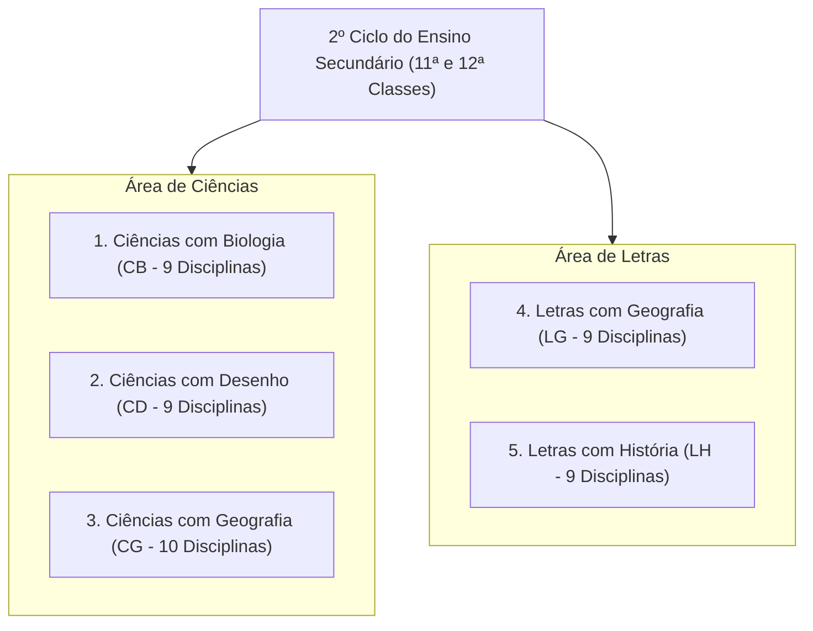
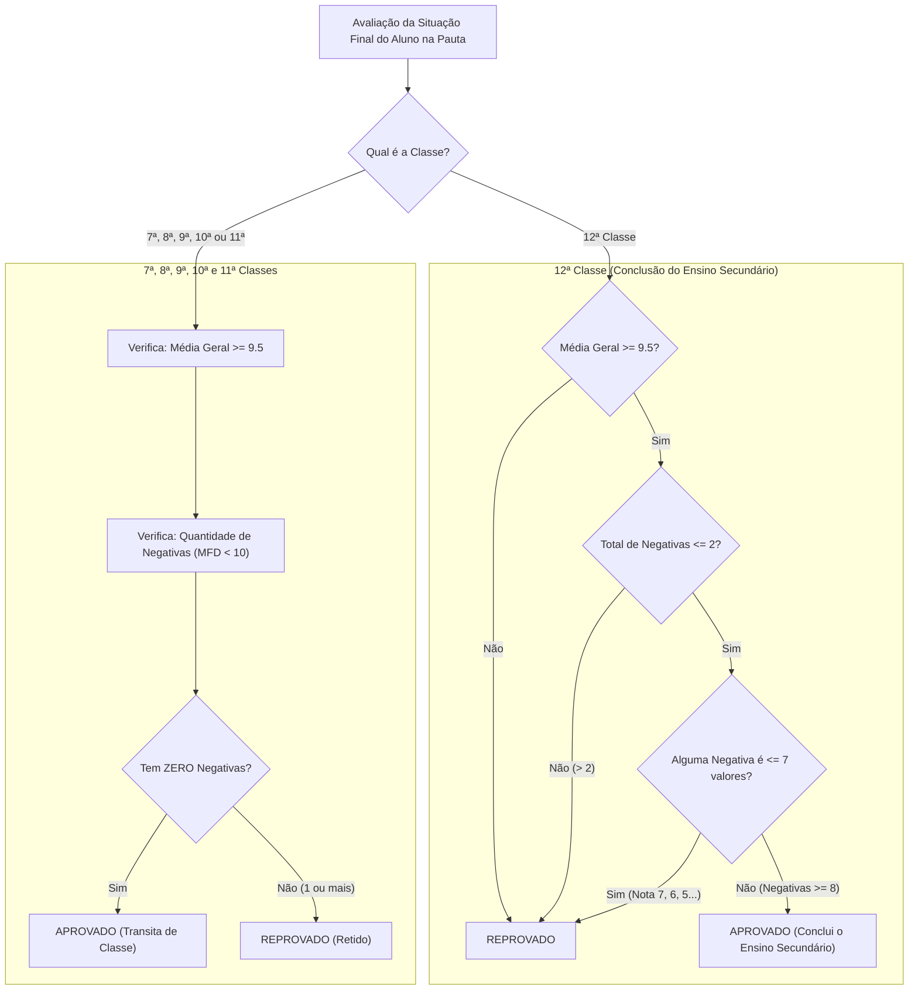

# 🇲🇿 Regras Pedagógicas e Curriculares Oficiais — MEC (Moçambique)

> **Norma Regulamentadora:** Ministério da Educação e Desenvolvimento Humano da República de Moçambique (MEC / MINEDH)  
> **Sistema Educacional:** Sistema Nacional de Educação (SNE) — Ensino Secundário Geral (ESG)  
> **Módulos de Código:** `backend/common/utils/avaliacoes_mocambique.py`, `backend/apps/pautas/services.py` e `backend/apps/disciplinas/services.py`

---

## 1. Enquadramento e Base Geográfica Oficial

O SIGE implementa integralmente o arcabouço normativo do Ministério da Educação e Desenvolvimento Humano de Moçambique.

### 1.1. Divisão Político-Administrativa Oficial de Moçambique
O sistema integra no seu banco de dados a totalidade das **11 Províncias** e **161 Distritos** de Moçambique (`backend/apps/tenants/models.py` e `geografia_mocambique.py`), estruturando o código oficial de cada escola com base na sua localização:

```
[Código Província: 2 dig] [Código Distrito: 2 dig] S [Sequencial Escola: 4 dig]
Exemplo: 0808S0001 (Inhambane -> Massinga -> Escola 0001)
```

| Província | Código | Distritos Abrangidos |
| :--- | :---: | :--- |
| **Niassa** | `01` | Cuamba, Lago, Lichinga, Majune, Mandimba, Marrupa, Maua, Mecanhelas, Mecula, Metarica, Muembe, N'gauma, Sanga |
| **Cabo Delgado** | `02` | Ancuabe, Balama, Chiúre, Ibo, Macomia, Mecúfi, Meluco, Metuge, Mocímboa da Praia, Montepuez, Mueda, Muidumbe, Namuno, Palma, Quissanga |
| **Nampula** | `03` | Angoche, Eráti, Ilha de Moçambique, Lalaua, Larde, Malema, Meconta, Mecubúri, Memba, Mogincual, Mogovolas, Moma, Monapo, Mossuril, Muecate, Murrupula, Nacala-a-Velha, Nacala Porto, Nampula, Rapale, Ribáuè |
| **Zambézia** | `04` | Alto Molócue, Chinde, Derre, Gilé, Gurué, Ile, Inhassunge, Luabo, Lugela, Maganja da Costa, Milange, Mocuba, Mocubela, Molumbo, Mopeia, Morrumbala, Mulevala, Namacurra, Namarroi, Nicoadala, Pebane, Quelimane |
| **Tete** | `05` | Angónia, Cahora-Bassa, Changara, Chifunde, Chiuta, Dôa, Macanga, Magoé, Marara, Marávia, Moatize, Mutarara, Tete, Tsangano, Zumbo |
| **Manica** | `06` | Báruè, Chimoio, Gondola, Guro, Macate, Machaze, Macossa, Manica, Mossurize, Sussundenga, Tambara, Vanduzi |
| **Sofala** | `07` | Beira, Búzi, Caia, Chemba, Cheringoma, Chibabava, Dondo, Gorongosa, Machanga, Marínguè, Marromeu, Muanza, Nhamatanda |
| **Inhambane** | `08` | Funhalouro, Govuro, Homoíne, Inhambane, Inharrime, Inhassoro, Jangamo, Mabote, Massinga, Maxixe, Morrumbene, Panda, Vilankulo, Zavala |
| **Gaza** | `09` | Bilene, Chibuto, Chicualacuala, Chigubo, Chókwè, Chongoene, Guijá, Limpopo, Mabalane, Manjacaze, Mapai, Massangena, Massingir, Xai-Xai |
| **Maputo Província** | `10` | Boane, Magude, Manhiça, Marracuene, Matola, Matutuíne, Moamba, Namaacha |
| **Maputo Cidade** | `11` | KaMpfumo, Nlhamankulu, KaMaxakeni, KaMavota, KaMubukwana, KaTembe, KaNyaka |

---

## 2. Matriz Curricular Nacional (7ª à 12ª Classe)

O currículo escolar divide-se em dois ciclos de formação com disciplinas obrigatórias e cargas horárias semanais regulamentadas:

### 2.1. 1º Ciclo do Ensino Secundário Geral (7ª, 8ª e 9ª Classes)
Estruturado em **Tronco Comum** uniforme composto por **11 disciplinas**:

| # | Disciplina | Código Canónico | Carga Horária Semanal |
| :-: | :--- | :---: | :---: |
| 1 | Língua Portuguesa | `LP` | 5 horas |
| 2 | Matemática | `MAT` | 5 horas |
| 3 | Língua Inglesa | `ING` | 3 horas |
| 4 | Física | `FIS` | 3 horas |
| 5 | Química | `QUI` | 3 horas |
| 6 | Biologia | `BIO` | 3 horas |
| 7 | Geografia | `GEO` | 3 horas |
| 8 | História | `HIS` | 3 horas |
| 9 | Educação Visual | `EV` | 2 horas |
| 10 | Educação Física | `EF` | 2 horas |
| 11 | Agropecuária | `AGRO` | 2 horas |
| **Total** | **Tronco Comum 1º Ciclo** | | **34 horas / semana** |

### 2.2. 2º Ciclo — 10ª Classe (Tronco Comum Transversal)
A 10ª Classe opera como consolidação do ciclo geral com **12 disciplinas**:
- Língua Portuguesa (`5h`), Matemática (`5h`), Língua Inglesa (`3h`), Física (`3h`), Química (`3h`), Biologia (`3h`), Geografia (`3h`), História (`3h`), Introdução à Filosofia (`2h`), Educação Física (`2h`), Agropecuária (`2h`) e Tecnologias de Informação e Comunicação — TIC's (`2h`). **Total: 36 horas/semana**.

### 2.3. 2º Ciclo — 11ª e 12ª Classes (5 Secções / Áreas Curriculares Específicas)
A partir da 11ª Classe, os alunos ingressam obrigatoriamente numa das **5 Secções Pré-Universitárias Oficiais**:



#### Composição Detalhada das 5 Secções:

1. **Ciências com Biologia (`CB` — 9 disciplinas):**
   Língua Portuguesa (`5h`), Língua Inglesa (`3h`), Introdução à Filosofia (`2h`), Educação Física (`2h`), Matemática (`5h`), Biologia (`4h`), Química (`4h`), Física (`4h`), TIC's (`2h`).
2. **Ciências com Desenho (`CD` — 9 disciplinas):**
   Língua Portuguesa (`5h`), Língua Inglesa (`3h`), Introdução à Filosofia (`2h`), Educação Física (`2h`), Matemática (`5h`), Física (`4h`), Desenho e Geometria Descritiva — DGD (`4h`), Química (`4h`), TIC's (`2h`).
3. **Ciências com Geografia (`CG` — 10 disciplinas):**
   Língua Portuguesa (`5h`), Língua Inglesa (`3h`), Introdução à Filosofia (`2h`), Educação Física (`2h`), Matemática (`5h`), Geografia (`4h`), Física (`4h`), Química (`3h`), Agropecuária (`2h`), TIC's (`2h`).
4. **Letras com Geografia (`LG` — 9 disciplinas):**
   Língua Portuguesa (`5h`), Língua Inglesa (`3h`), Língua Francesa (`3h`), Introdução à Filosofia (`3h`), História (`4h`), Geografia (`4h`), Matemática Aplicada (`3h`), Educação Física (`2h`), TIC's (`2h`).
5. **Letras com História (`LH` — 9 disciplinas):**
   Língua Portuguesa (`5h`), Língua Inglesa (`3h`), Língua Francesa (`3h`), Introdução à Filosofia (`3h`), História (`5h`), Geografia (`3h`), Introdução à Literatura (`3h`), Educação Física (`2h`), TIC's (`2h`).

> [!IMPORTANT] Princípio do Isolamento Estrito de Secção
> O motor curricular do SIGE (`CURRICULO_REGRAS_AREAS`) impede que disciplinas exclusivas de Letras (ex: *Língua Francesa* ou *Introdução à Literatura*) constem em turmas de Ciências, ou que disciplinas como *Física*, *Química* e *Biologia* figurem em pautas de turmas de Letras.

---

## 3. Fórmulas Oficiais de Avaliação e Cálculo de Médias

Todas as notas de avaliação obedecem à escala numérica de **0 a 20 valores**.

### 3.1. Instrumentos Trimestrais de Avaliação
Em cada um dos 3 trimestres (`1_TRIMESTRE`, `2_TRIMESTRE`, `3_TRIMESTRE`), a avaliação é composta por:
- `teste1`: **1ª ACS** (1ª Avaliação Contínua e Sistemática — Obrigatória)
- `teste2`: **2ª ACS** (2ª Avaliação Contínua e Sistemática — Obrigatória)
- `teste3`: **3ª ACS** (3ª Avaliação Contínua — Opcional)
- `teste4`: **MAP** (Média de Avaliações Práticas / Laboratoriais — Opcional)
- `trabalho`: **MAS** (Média de Avaliações Sistemáticas / Trabalhos — Opcional)
- `avaliacao_trimestral`: **AT** (Avaliação Trimestral / ACP — Prova Global Obrigatória)

### 3.2. Condição de Fechamento da Média Trimestral (`MT`)
A nota da Média Trimestral (`MT`) só pode ser apurada se o aluno tiver:
- Pelo menos **duas avaliações contínuas válidas** (`1ª ACS` e `2ª ACS`);
- A prova **AT** realizada.
Se estes critérios não forem cumpridos, a situação da disciplina permanece **Pendente** (`MT = None`).

### 3.3. Fórmulas de Cálculo

1. **Média das Avaliações Contínuas (`MAC`):**
   Calcula a média aritmética simples de todas as avaliações contínuas efetivamente realizadas:
   $$\text{MAC} = \text{round}\left(\frac{\sum \text{Avaliações Contínuas Válidas}}{N}, 1\right)$$
   *(Nota de engenharia: zeros decorrentes de testes opcionais não realizados não devem rebaixar a média dos testes válidos já cumpridos).*

2. **Média Trimestral (`MT`):**
   Combina com peso 2 a média contínua (`MAC`) e com peso 1 a prova trimestral (`AT`), arredondando para o **inteiro mais próximo**:
   $$\text{MT} = \text{round}\left(\frac{2 \times \text{MAC} + \text{AT}}{3}\right)$$
   *Exemplos de arredondamento oficial:*
   - $9.50 \to 10$ (Positiva)
   - $9.49 \to 9$ (Negativa)
   - $13.50 \to 14$

3. **Média Final da Disciplina (`MFD` — Anual):**
   Média aritmética das 3 médias trimestrais arredondada para o inteiro mais próximo:
   $$\text{MFD} = \text{round}\left(\frac{\text{MT}_1 + \text{MT}_2 + \text{MT}_3}{3}\right)$$

---

## 4. Critérios Oficiais de Aprovação e Transição na Pauta Anual

A deliberação de fim de ano letivo segue regras estritamente diferenciadas por classe na função `avaliar_aprovacao_pauta()`:



### 4.1. Regra Geral da 7ª à 11ª Classe: Princípio dos 100% de Positivas
- O estudante **SÓ APROVA** se obtiver $\text{MFD} \ge 10$ valores em **TODAS as disciplinas** da sua grelha curricular (**exatamente zero negativas**).
- Uma única nota negativa ($\le 9$ valores) em qualquer disciplina determina a **Reprovação / Retenção** imediata do aluno.

### 4.2. Regra Especial da 12ª Classe (Regime de Tolerância Pré-Universitário)
Na 12ª Classe, o aluno é considerado **Aprovado** se satisfizer simultaneamente três condições:
1. **Média Geral Anual $\ge 9.5$ valores** ($\ge 10$ arredondado);
2. **No máximo 2 disciplinas com nota negativa** ($\le 9$ valores);
3. **Piso Mínimo de 8 valores:** Nenhuma nota negativa pode ser inferior a 8 valores.
> **Alerta Normativo:** Se um aluno da 12ª classe tiver uma nota negativa de 7, 6 ou 5 valores, ele está **automaticamente reprovado**, mesmo que sua média geral seja superior a 14 valores.

---

## 5. Escala Qualitativa de Avaliação e Anotações Oficiais

### 5.1. Tabela Qualitativa Oficial de Comportamento / Aproveitamento

| Intervalo de Notas | Sigla Oficial | Classificação Qualitativa | Destaque Visual |
| :---: | :---: | :--- | :---: |
| **18.5 a 20.0** | **E** | Excelente | Azul / Preto |
| **16.5 a 18.4** | **MB** | Muito Bom | Azul / Preto |
| **13.5 a 16.4** | **B** | Bom | Preto |
| **9.5 a 13.4** | **S** | Suficiente (Positiva) | Preto |
| **0.0 a 9.4** | **NS** | Não Suficiente (Negativa) | **Vermelho** |

### 5.2. Siglas Oficiais de Anotação Regulamentar (`anotacao`)
No livro de ponto, caderneta eletrónica e pautas de turma:
- **`D` — Dispensado:** Aluno com desempenho superior dispensado por regulamento.
- **`T` — Transferido:** Aluno transferido para outro estabelecimento durante o período.
- **`VT` — Veio Transferido:** Aluno admitido por transferência de outra escola.
- **`F` — Faleceu:** Falecimento comunicado e comprovado.
- **`AM` — Anulou a Matrícula:** Cancelamento formal de matrícula a pedido ou médico.
- **`PPF` — Perdeu por Faltas:** Ultrapassou o limite legal de faltas não justificadas.
- **`PDF` — Perdeu por Disciplina:** Excluído por processo disciplinar homologado.
